# Existing Architecture: OAN Production-like Deployment on AWS

This document visualizes the active, production-like deployment of OpenAgriNet (OAN) on AWS, covering the Gateway, Grievance, A2C, Storage, etcd, and Logging infrastructure.

---

## 1. High-Level Architecture Diagram (Mermaid)

```mermaid
flowchart TB
    %% External Actors
    subgraph EXT["External Access"]
        Users["Public Users & Partners<br/>(Browsers, IVR, OpenG2P)"]
        Admins["Operators & Jenkins<br/>(WireGuard Clients)"]
        R53["Route 53 DNS<br/>(*.arnavam.tech)"]
    end

    %% AWS VPC Boundary
    subgraph VPC["AWS VPC: 10.20.0.0/16 (oan-prodlike-vpc)"]

        %% Public Subnet
        subgraph PUBA["Public Subnet A: 10.20.0.0/24 (AZ ap-south-1a)"]
            subgraph GW["Gateway Node (t3a.medium | 10.20.0.10 | EIP: 3.108.29.44)"]
                WG["WireGuard Server<br/>(UDP 51820)"]
                APISIX["Apache APISIX<br/>(hostPort 80/443 | TLS Termination)"]
                AIC["apisix-ingress-controller"]
                GWValkey[("APISIX Valkey<br/>(Rate Limits)")]
            end
            NAT["NAT Instance (t3a.nano | 10.20.0.30 | EIP: 13.200.74.221)<br/>Outbound egress for private subnets"]
        end

        %% Private Subnet A
        subgraph PRIVA["Private Subnet A: 10.20.10.0/24 (AZ ap-south-1a)"]
            subgraph GRV["Grievance Cluster (t3a.large | 10.20.10.20)"]
                GRV_Web["Grievance Web<br/>(NodePort 30800)"]
                GRV_Sock["Grievance Socket.IO<br/>(NodePort 30900)"]
                GRV_Workers["Workers & Scheduler<br/>(Routing, SLA, Scan, Celery)"]
                GRV_Valkey[("Valkey Cache & Queue")]
                GRV_Clam["ClamAV Antivirus"]
                GRV_OTel["OTel Agent (DaemonSet)"]
            end

            subgraph A2C["A2C Cluster (t3a.medium | 10.20.10.30)"]
                A2C_Web["A2C Web<br/>(NodePort 30810)"]
                A2C_Workers["Workers & Scheduler"]
                A2C_Valkey[("Valkey Cache & Queue")]
                A2C_OTel["OTel Agent (DaemonSet)"]
            end

            subgraph STORAGE["Storage Host (t3a.small | 10.20.10.10)"]
                MDB[("MariaDB 10.11 Server<br/>(Port 3306 | TLS Enforced)")]
                NFS[("NFSv4 Server<br/>(/srv/nfs/k8s RWX Volumes)")]
            end

            subgraph LOG["Logging Cluster (t3a.medium | 10.20.10.40)"]
                OTEL_GW["OTel Gateway Collector<br/>(NodePort 30317)"]
                LOKI[("Grafana Loki (Single Binary)")]
                MINIO[("MinIO Bucket (on NFS)")]
                GRAFANA["Grafana UI<br/>(Port 3000)"]
            end

            ETCD1[("etcd-1 (t3a.nano | 10.20.10.51)<br/>Cluster Member 1")]
        end

        %% Private Subnet B
        subgraph PRIVB["Private Subnet B: 10.20.11.0/24 (AZ ap-south-1b)"]
            ETCD2[("etcd-2 (t3a.nano | 10.20.11.52)<br/>Cluster Member 2")]
        end

        %% Private Subnet C
        subgraph PRIVC["Private Subnet C: 10.20.12.0/24 (AZ ap-south-1c)"]
            ETCD3[("etcd-3 (t3a.nano | 10.20.12.53)<br/>Cluster Member 3")]
        end
    end

    %% Inbound Client & Admin Flows
    Users -->|"HTTPS (443)"| R53
    R53 -->|"Public Traffic"| APISIX
    Admins -->|"Admin VPN (UDP 51820)"| WG
    WG -.->|"SSH (22) & kubectl (6443)"| GRV
    WG -.->|"SSH (22) & kubectl (6443)"| A2C
    WG -.->|"SSH (22) & kubectl (6443)"| LOG
    WG -.->|"SSH (22)"| STORAGE
    Admins -.->|"kubectl port-forward (3000)"| GRAFANA

    %% Gateway to App Upstream Flows
    APISIX -->|"HTTP Hop (NodePort 30800 / 30900)"| GRV_Web
    APISIX -->|"HTTP Hop (NodePort 30810)"| A2C_Web
    APISIX <-->|"Read/Write Route Config (2379)"| ETCD1
    APISIX <-->|"Read/Write Route Config (2379)"| ETCD2
    APISIX <-->|"Read/Write Route Config (2379)"| ETCD3
    APISIX <-->|"Rate-limit Counters"| GWValkey

    %% Raft Consensus Sync
    ETCD1 <-->|"Raft Peering (2380)"| ETCD2
    ETCD2 <-->|"Raft Peering (2380)"| ETCD3
    ETCD1 <-->|"Raft Peering (2380)"| ETCD3

    %% Database & Storage
    GRV_Web & GRV_Workers -->|"TLS (3306)"| MDB
    A2C_Web & A2C_Workers -->|"TLS (3306)"| MDB
    GRV -->|"NFS CSI Mount (2049)"| NFS
    A2C -->|"NFS CSI Mount (2049)"| NFS
    LOKI & MINIO -->|"NFS CSI Mount (2049)"| NFS

    %% Log Telemetry Pipeline
    GRV_OTel & A2C_OTel -->|"OTLP gRPC (30317)"| OTEL_GW
    OTEL_GW --> LOKI
    LOKI --> MINIO
    GRAFANA --> LOKI
```

---

## 2. Infrastructure Component Matrix

| Host / Instance | Role | Type | Private IP | Public IP | Key Services |
|---|---|---|---|---|---|
| **`gateway`** | Edge Gateway & Admin Entrypoint | `t3a.medium` | `10.20.0.10` | `3.108.29.44` (Elastic IP) | Apache APISIX (80/443), Ingress Controller, APISIX Valkey, WireGuard (UDP 51820) |
| **`nat`** | Outbound Internet Egress | `t3a.nano` | `10.20.0.30` | `13.200.74.221` (Elastic IP) | `iptables` NAT router for private instances |
| **`grievance`** | Grievance Service Backend | `t3a.large` | `10.20.10.20` | None (Private) | Frappe Gunicorn (30800), Socket.IO (30900), Workers, ClamAV, Valkey |
| **`a2c`** | Access to Credit Backend | `t3a.medium` | `10.20.10.30` | None (Private) | Frappe Gunicorn (30810), Workers, Valkey |
| **`storage`** | Shared Database & File Storage | `t3a.small` | `10.20.10.10` | None (Private) | MariaDB 10.11 (3306, TLS required), NFSv4 Server (2049, 20 GB dedicated disk) |
| **`logging`** | Observability & Telemetry | `t3a.medium` | `10.20.10.40` | None (Private) | OpenTelemetry Gateway (30317), Loki (Log store), MinIO (S3 on NFS), Grafana (3000) |
| **`etcd-1`** | APISIX Data Store (Member 1) | `t3a.nano` | `10.20.10.51` | None (Private) | etcd (AZ `ap-south-1a`, ports 2379/2380) |
| **`etcd-2`** | APISIX Data Store (Member 2) | `t3a.nano` | `10.20.11.52` | None (Private) | etcd (AZ `ap-south-1b`, ports 2379/2380) |
| **`etcd-3`** | APISIX Data Store (Member 3) | `t3a.nano` | `10.20.12.53` | None (Private) | etcd (AZ `ap-south-1c`, ports 2379/2380) |

---

## 3. Key Architectural Boundaries & Isolation

1. **Edge & Client Access**:
   - Only the `gateway` node is exposed on port 80/443. All other app nodes run in private subnets without public IPs.
   - Client requests (`grievance.arnavam.tech`, `a2c.arnavam.tech`) terminate TLS at APISIX using a single customer-supplied wildcard certificate.
2. **Hop Isolation (Gateway → Apps)**:
   - Traffic between APISIX and the Frappe applications travels across private AWS VPC subnets to designated NodePorts (`30800`, `30900`, `30810`).
   - App NodePorts accept connections strictly from the Gateway security group.
3. **Database & Persistence**:
   - MariaDB enforces TLS encryption (`require_secure_transport=ON`). Pods verify the database using an internal CA certificate embedded in the image.
   - Shared Frappe files and log chunks are mounted over NFSv4 with `all_squash` (UID/GID 1000) using the Kubernetes NFS CSI driver.
4. **Log Telemetry Pipeline**:
   - DaemonSet OTel agents collect container stdout, redact personal data (PII) at node level, and forward gRPC batches over private port `30317` to the OTel Gateway on the logging cluster.
