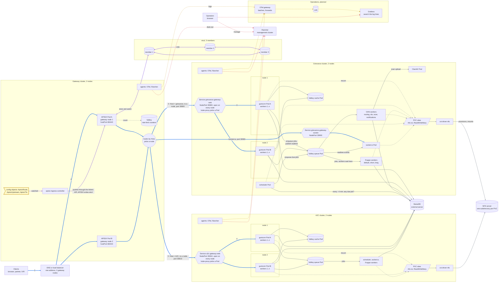
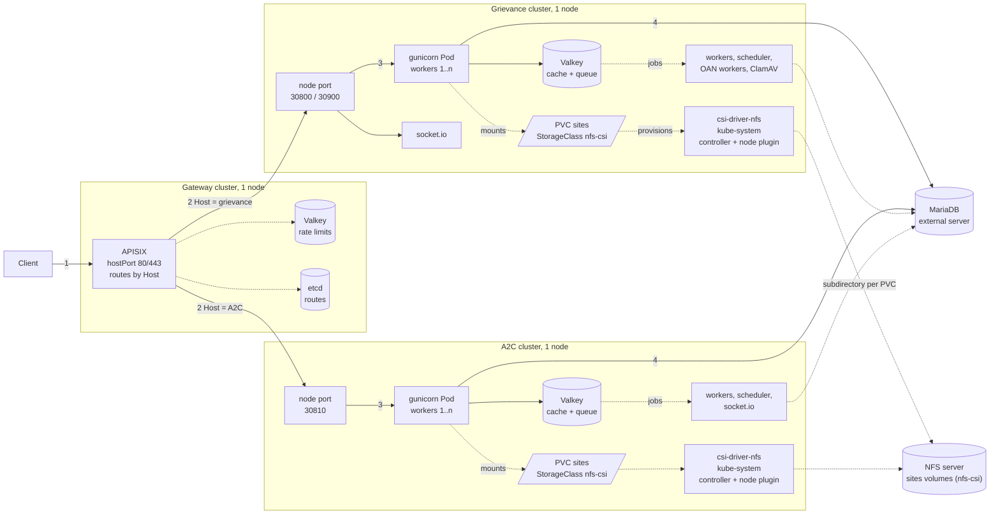

# Request flow, load balancing, logging and Rancher

How a request travels from a client to Frappe when the gateway and the app clusters have
several nodes and several Pods, which layer spreads the load at each step, where logs go,
and where Rancher sits.

Today each cluster has one node and one gunicorn Pod per app. The gateway chart takes a
list of nodes per app (`externalHosts`) with a health check, but only one node has been
tried. The diagram shows the target layout; "What exists today" at
the end separates what is installed from what is only planned.

Two nodes per cluster show the difference between one and many. etcd has three members,
because a majority is needed. Lines are coloured by what they carry:

| Colour | Carries |
|---|---|
| Blue, numbered 1 to 4 | The request path: client, DNS, APISIX, node port, Service, Pod |
| Purple | Gateway configuration: the `Apisix*` resources, the controller, the Admin API, etcd |
| Grey | Data: database, Valkey, the job queue, NFS |
| Yellow, dotted | Logs and errors |
| Red, dotted | Management: Rancher and operators |

The yellow note is a configuration object, not a running program. A Service is not a
machine: it is a virtual address that `kube-proxy` rules on every node implement, and a
NodePort Service opens its port on every node. Everything under "Operations, planned" and
the OTel and Rancher agents is not installed yet; see [What exists today](#what-exists-today). Sentry is left out of the pipeline for now.

## Pods in one app release

Both apps use the upstream chart's Deployments. Each one is its own Pod, so each scales
and fails on its own. Rendered with `helm template` from the dev values.

| Pod | Role | In |
|---|---|---|
| `gunicorn` | HTTP API, runs several worker processes inside one Pod | both |
| `socketio` | realtime, own node port (30900 for grievance) | both |
| `scheduler` | enqueues scheduled jobs; keep one replica | both |
| `worker-d`, `worker-s`, `worker-l` | Frappe background workers (default, short, long queues) | both |
| `worker-routing`, `worker-sla`, `worker-scan`, `worker-notifications` | OAN queue workers | grievance only |
| `clamav` | virus scanner for uploads | grievance only |
| `valkey-cache`, `valkey-queue` | Frappe cache and job queue (Deployments, not StatefulSets) | both |
| `mariadb-sts` | database; off, the server is external (`frappe.dbHost`) | both |
| `nginx` | present with 0 replicas; APISIX replaces it | both |
| jobs | `conf-bench`, `new-site`, `site-config` run on install and upgrade | both |

## Smallest layout: one node at most

One gateway node, one node per app, one Pod per Deployment, no load balancer. MariaDB and
the NFS server are external, as in the [overlay](external-db-and-nfs.md). The numbers on the lines
are the order of one request. Dotted lines are background work.

The gateway still reaches each app cluster by node address and node port, because the
clusters are separate. Collapsing to one cluster is possible (APISIX could then use
Service names), but the charts and the Host-based routing are built for separate clusters.
Logging and Rancher are left out: logs stay in `kubectl logs`, and Rancher is optional.

## Who balances what

| Step | Layer | Spreads requests across | If one of them fails |
|---|---|---|---|
| 1 | DNS or a load balancer | gateway nodes | traffic goes to the other gateway nodes (needs health checks on the load balancer) |
| 2 | APISIX upstream (`externalNodes`) | the app cluster's nodes | APISIX marks the node unhealthy and stops sending to it |
| 3 | Service (`kube-proxy`) | Pods behind the Service, on any node | the Service stops using the Pod once it is not ready |
| 4 | gunicorn master | its own worker processes | the master restarts a dead worker |

A node port is open on every node of the cluster. A request that arrives at node 1's node
port can be forwarded to a Pod on node 2, one extra hop inside the cluster. Setting the
Service's `externalTrafficPolicy: Local` keeps traffic on the node that received it, but
then a node with no ready Pod must fail its health check so APISIX skips it.

APISIX picks the app by the `Host` header. Both apps serve `/v1/auth/*`, so the host name
is the only separator. An unknown host gets `404 Route Not Found`.

## etcd for APISIX

APISIX keeps its routes, upstreams and certificates in etcd. The ingress controller
writes them there from the `Apisix*` resources in the gateway cluster. APISIX reads them
at start and watches for changes. If etcd is down, running APISIX Pods keep serving the
routes they already hold; they cannot load new ones. I expect this from how APISIX works
and have not tested it here.

| | Dev and the lab | Production |
|---|---|---|
| Where | `externalEtcd`: three etcd processes on one VM, other ports | `externalEtcd`: three machines outside Kubernetes, one etcd service on each |
| Members | 3, but on one machine, so only a process can fail | 3, so one machine can fail and the other two still form a majority |
| Storage | the VM's disk | fast local SSD, never NFS or EFS |
| Security | a user and password (`externalEtcd.user`, `existingSecret`), no TLS | the same, plus TLS between members and from APISIX |
| Backup | none | scheduled `etcdctl snapshot save`, copied off the machine |
| Ports | cluster-internal | 2379 from the APISIX nodes only, 2380 between the members only |

- **Why three machines:** the members vote, and a change counts only when a majority
  agrees. Three services on one server would all fail together, so each member needs its
  own machine, in different availability zones.
- **Dedicated or shared:** three small dedicated servers are the cleaner choice. The
  fallback is one member on the host of each of three gateway nodes, outside Kubernetes.
  Then a gateway node failure takes an APISIX Pod and an etcd member together, and a
  reboot needs a health check first. Which one is used is a decision for whoever runs the
  platform.
- **Size:** small. The built-in single member used about 153 MiB on a laptop cluster. A
  small instance with 2 vCPU and a few GB per member is my estimate for production.
- **Not Kubernetes' own etcd.** RKE2 runs one for the cluster API, and it needs the same
  things (three server nodes, SSD, snapshots), but RKE2 sets up its TLS, joining and
  snapshot schedule itself. APISIX's etcd has none of that automation. Never point APISIX
  at the cluster's etcd: it holds every Secret.

## Walk through one request

1. The client resolves `grievance-backend-dev.oanstaging.com` and reaches one gateway
   node through DNS or the load balancer.
2. APISIX on that node terminates TLS and matches the route by `Host` and path. It checks
   the rate limit in Valkey (the same counters for every APISIX Pod), then CORS, API
   keys and IP rules.
3. APISIX picks a healthy node from the upstream's `externalNodes` and sends plain HTTP
   to that node's port 30800. It rewrites `Host` to the Frappe site name.
4. `kube-proxy` on that node hands the connection to one ready gunicorn Pod, possibly on
   another node.
5. A gunicorn worker handles it, reading the database and the shared sites volume.

## Logging

Every container writes to stdout and stderr; nothing is read from log files.

| Source | What it logs | How it reaches the collector |
|---|---|---|
| Frappe containers | `FRAPPE_STREAM_LOGGING=1` sends `frappe.logger()` to stdout. Outside the dev server only `ERROR` and above are logged. | container stdout |
| APISIX | access and error logs | container stdout |
| Workers, socket.io, jobs | same as Frappe | container stdout |
| Errors with stack traces | every 5xx in the API wrapper, through `frappe.log_error` | Sentry directly, when Secret `oan-<app>-sentry` (key `dsn`) exists |

The collection path, as OpenG2P describes it ([deployment guides](https://docs.openg2p.org)):

1. An OpenTelemetry agent runs on every node of every cluster as a DaemonSet and reads
   the container logs.
2. It redacts personal data on the node, before the logs leave it (OpenG2P's
   [system monitoring docs](https://docs.openg2p.org/platform/platform-services/system-monitoring.md)
   place redaction in the agent; they do not say whether it is a collector processor
   or custom code, or which fields it covers). It forwards the logs to an OpenTelemetry
   gateway, which batches them and sends them to Loki.
3. Loki stores them on object storage. Loki has no interface of its own.
4. Grafana searches them (LogQL), draws dashboards and sends alerts, for example to Slack.
5. Sentry is separate. It groups errors and keeps stack traces. It does not replace the
   log pipeline, and the log pipeline does not replace it.

Frappe puts request bodies into Sentry events. Add a scrubbing rule on the Sentry project
that removes `contexts."JSON Body"` and `contexts."Form Data"` before turning it on.

Logs and the request path never share a hop: if the collector is down, requests still
work and the container runtime keeps the most recent logs on the node until it rotates
them.

## Rancher

Rancher is a management console. It is not in the request path.

- It runs on a cluster of its own (the management cluster). Each other cluster is
  imported and runs a `cattle-cluster-agent` that connects outward to Rancher over HTTPS,
  so the clusters need no inbound port for Rancher.
- Operators use Rancher to see Pods, jobs, volumes and logs, open a shell in a Pod, and
  install or upgrade Helm releases from a chart repository. Grafana is reachable from its
  UI in the OpenG2P setup.
- Its own state is Kubernetes objects in the management cluster's datastore (etcd on
  RKE2, SQLite on single-node k3s). Back that cluster up (the `rancher-backup` operator)
  before relying on it.
- If Rancher is down, the apps and the gateway keep working. You lose the console, not
  the service. `kubectl` and `helm` still work.
- Anyone who can open a release in Rancher can read its values. Give each namespace its
  own Rancher project.

## What happens on failures

| Failure | Result |
|---|---|
| One gunicorn Pod dies | The Service drops it. The other Pods keep serving. Kubernetes starts a replacement. |
| One app node dies | APISIX health checks mark it down. Pods on the other nodes serve. Pods from the dead node are rescheduled if there is room. |
| One etcd member dies (production, 3 members) | The other two keep the majority. Routes keep working and can still change. A second failure stops route changes; running APISIX Pods are expected to keep serving (untested). |
| The only etcd dies (dev) | Routes cannot change. Running APISIX Pods are expected to keep their routes until restarted (untested). |
| One gateway node dies | The load balancer or DNS stops using it. The other gateway nodes serve. |
| The NFS server dies | Every Pod that needs the sites volume fails or hangs. NFS is a single point of failure until it is made redundant. |
| The database server dies | Every Pod fails its database calls. Same: redundancy is separate work. |
| The log collector or Loki dies | Requests are unaffected. Recent logs stay on the nodes until they rotate; older ones are lost for the gap. |
| Sentry is unreachable | Requests are unaffected. Error reports from that period are lost. |
| Rancher is down | No console. Apps, gateway and `kubectl`/`helm` keep working. |

## What exists today

| Part | Status |
|---|---|
| Gateway cluster with APISIX and Valkey, one node | built and tested on OrbStack |
| Grievance and A2C app clusters, one node, one Pod each | built and tested on OrbStack |
| Several gateway nodes, several app nodes | the gateway chart takes `externalHosts` (a list) and `healthCheck` per app, generated by `oan_auth_service/gateway_apisix.py`. Rendered, and accepted by a server-side dry run against the controller's CRD; not tried with real traffic. APISIX still needs one replica per node (`hostPort`) and a load balancer in front. |
| External MariaDB and NFS | the base app values use them ([external-db-and-nfs.md](external-db-and-nfs.md)); rendered with `helm template`, not installed against a real server. NFS on k3d is untested. |
| Several Pods per app | possible by raising replicas in the values. The sites volume is ReadWriteMany on NFS. socket.io needs sticky routing or websocket-only clients; I have not checked the realtime route. |
| Stdout logging | on (`FRAPPE_STREAM_LOGGING=1`) |
| OpenTelemetry, Loki, Grafana | not installed. Memory is the limit on a laptop. Placement is open: in the management cluster, or a cluster of its own. |
| Sentry | not installed. The Secret hook exists in both charts. |
| Rancher | tested locally on its own k3d cluster with the OrbStack cluster imported. Dev's Rancher version and install method are unconfirmed. |
| etcd | `apisix.yaml` sets `etcd.enabled: false` and `externalEtcd`; the three member URLs are passed at install. Rendered with `helm template`; no etcd cluster has been run against it. |
| Valkey | single instance. If it is down, the rate-limit plugin follows its `allow_degradation` setting. |
